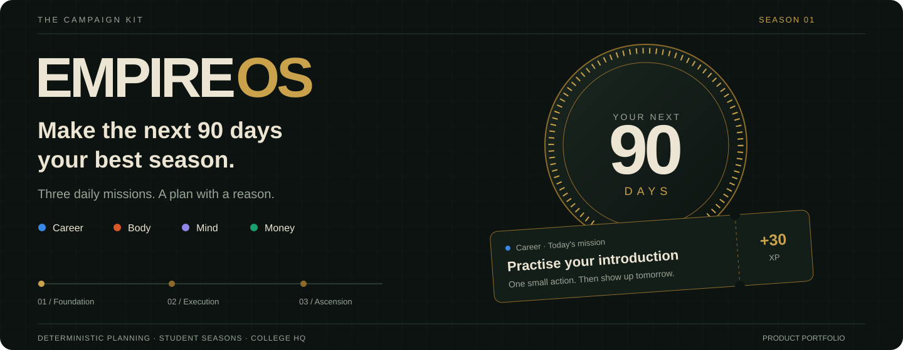
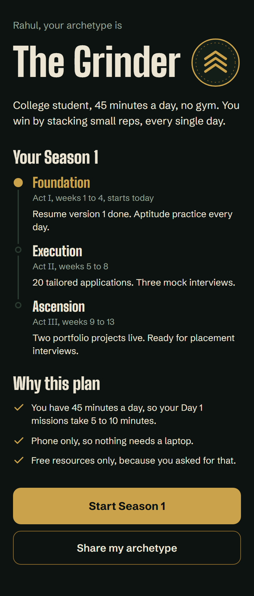
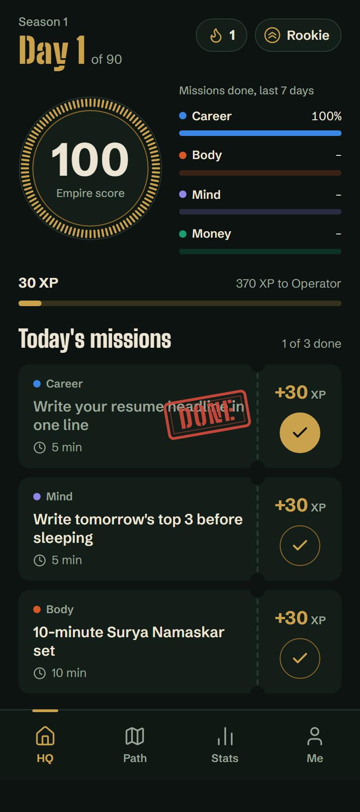
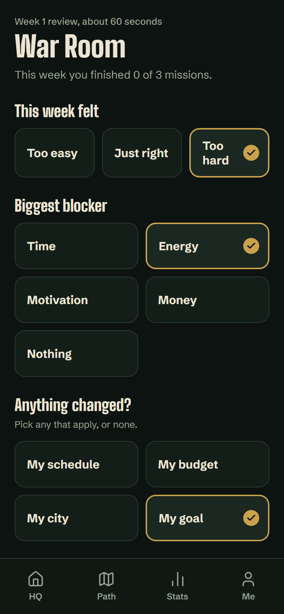
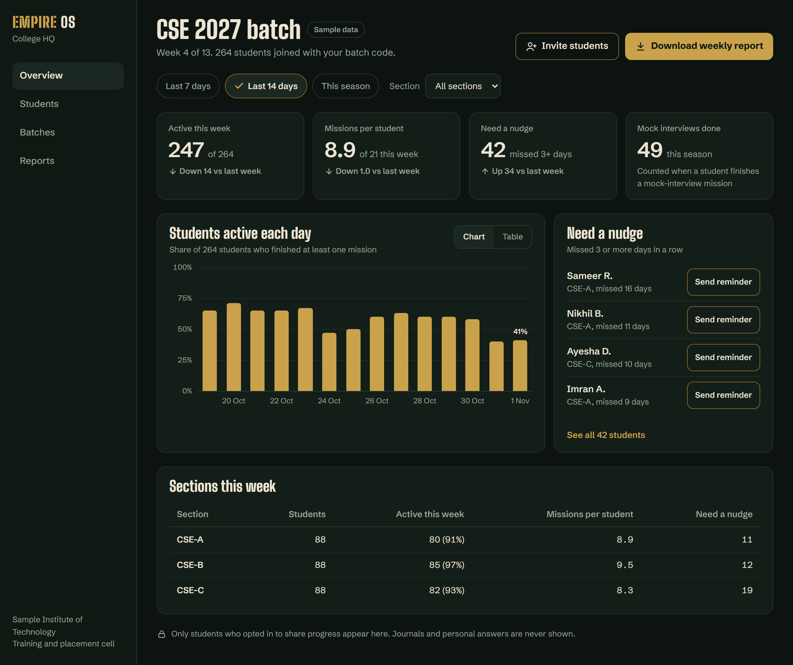

  

# EMPIRE OS

   

**Turn your next 90 days into a season.** A phone-first web app that gives students three short daily missions across **Career, Body, Mind and Money**, fitted to their time, budget and equipment. Complete a ticket, earn XP, build a streak, and adjust the next week through a short review.

Built for students and freshers in India, with a separate **College HQ** for training and placement teams running consenting student batches.

[Take the reviewer tour](docs/DEMO.md) · [Read the case study](docs/CASE_STUDY.md) · [Explore the architecture](docs/ARCHITECTURE.md) · [Browse all documentation](docs/README.md)

**Current stage:** application workflows are implemented and tested locally. Real Supabase sign-in and database configuration, Vercel deployment, and payment-provider verification are pending. There is no verified public live demo. The repository is private; reviewers need access from the owner. Screenshots use fictional local test data.

## The product in one loop

**Answer → get a season → complete today's missions → review the week → adapt.**

A student may know what they want to improve without knowing what to do today. EMPIRE OS turns that broad intention into a small, specific task: practise an introduction, take a short walk, prepare tomorrow's priorities, or review recent spending.

Its planning engine uses explicit rules rather than an AI request. A phone-only student with no spending budget gets different eligible missions from someone with a laptop and gym access. Each plan can explain the choices it made.

The intended outcome is more consistent action. Employment, health, savings, retention and revenue outcomes have **not** been established with real users. Missions are general habits, not professional medical, financial or legal advice.

## See the app

<table>
  <tr><th>A plan with a reason</th><th>Today's mission tickets</th><th>A weekly reset</th></tr>
  <tr>
    <td></td>
    <td></td>
    <td></td>
  </tr>
</table>

College HQ, season map and landing page

<table>
  <tr><th>The season map</th><th>The first impression</th></tr>
  <tr>
    <td></td>
    <td></td>
  </tr>
</table>

These are rendered application screens captured in local test mode. Sample names, activity and college figures are generated fixtures. [Capture notes and refresh instructions](docs/images/README.md).

## What is implemented

| Area | Application behavior | Verification boundary |
| --- | --- | --- |
| Onboarding | Adult age gate, eleven-question quiz, six archetypes, three-act preview, oath and sign-up screens | Quiz and pretend sign-in tested locally; real email/Google flow pending |
| Daily missions | 120 core missions and four ten-mission packs; eligibility and scoring for time, cost, equipment, act and difficulty | Deterministic rules and local browser flows tested |
| Game loop | Done stamps, XP, ranks, streaks, shields, daily bonus, twelve medals from real activity, swap/skip, HQ, Path, Stats and Me | Local services and browser tests; hosted data path pending |
| War Room | Weekly review, easier/harder/free-only adjustments, explanations, boss missions and confirmation for a new plan | Tested with a local clock and in-memory store |
| College HQ | Consent-based batch joining, overview, students, sections, in-app nudges, invite poster and printable report | Generated batch and permission scenarios tested locally; live organization isolation pending |
| Founder HQ | Funnel, return metrics, reservations, launch checklist, college/batch setup and demo requests | Local fixture workflows; figures are not customer traction |
| Sharing and privacy | PNG share cards, capped referral rewards, JSON export and account deletion | Local tests; real devices and hosted deletion still need checks |
| Season Pass | Reverse trial, Free tier, reservation flow, server-verified Razorpay integration and receipts | Reserve mode by default; checkout tested against a stand-in gateway |
| Website | Student landing, college buyer page, two guides, metadata, sitemap and install assets | Build and browser checks; live preview/performance checks pending |

The [roadmap](docs/ROADMAP.md) separates delivery from launch work. [BUILD_PLAN](docs/BUILD_PLAN.md) remains the source for verified phase checkboxes; an implemented feature is not automatically a completed live rollout.

## A visual language built around the season

The **campaign kit** uses forest ink, brass and bone, with perforated mission tickets, a ticked medallion for the season, and a red DONE stamp. The visual system supports the work: a mission feels like a small ticket to finish, while the map makes the longer season visible.

The design target is **390 × 844**, with 44px tap targets, status words alongside color, reduced-motion behavior, and table alternatives to charts. These are documented design requirements and tested patterns; a complete real-device and assistive-technology review is still pending. [Design specification](docs/DESIGN.md) · [Original reference screens](design/screens/README.md).

## Architecture at a glance

~~~mermaid
flowchart TD
    Student["Student phone"] --> App["Next.js App Router Screens + server actions"]
    College["College team / Founder"] --> App
    App --> Identity["Session and role checks Validated inputs"]
    Identity --> Services["Server services Season · College · Review · Payment"]
    Services --> Rules["Pure rules Plans · XP · Access · Adaptation"]
    Services --> Store["SeasonStore interface"]
    Store --> Memory["Local test mode In-memory fixture store"]
    Store --> Supabase["Live target Supabase Postgres + RLS"]
    Services --> Payments["Payment gateway Razorpay / local stand-in"]
~~~

Services own the permission checks and game-state changes. The live store uses a server-only Supabase secret client, so those checks matter even where database row-level security (RLS) also protects direct authenticated access. Local MemoryStore tests do not prove the hosted configuration works. [Architecture](docs/ARCHITECTURE.md) · [Security boundaries](docs/SECURITY.md).

| Layer | Technology |
| --- | --- |
| Application | Next.js 16 App Router, React 19, strict TypeScript |
| Interface | Tailwind CSS 4, custom SVG emblems, Lucide icons, Motion |
| Planning | Pure TypeScript rules, one plan configuration, no AI API in V1 |
| Live data and identity | Supabase Postgres, email one-time code and Google sign-in; configuration pending |
| Local evaluation | MemoryStore for demo/service tests; PGlite for migration and database-policy tests |
| Verification | Vitest, Playwright at phone size, selected axe accessibility checks |
| Deployment target | Vercel; not verified live |

## Try it locally without accounts

The project declares **Node.js 24**. Use an installed Node.js 24 environment and npm. GitHub access is required to clone this private repository.

~~~powershell
git clone https://github.com/akhil-itpro/empire-os.git
cd empire-os
npm.cmd ci

$env:EMPIRE_TEST_MODE='1'
$env:NEXT_PUBLIC_EMPIRE_TEST_MODE='1'
$env:EMPIRE_DIST_DIR='.next-test'
npm.cmd run dev -- --port 3200
~~~

Open **http://localhost:3200**. Choose **Find your archetype**, finish the quiz and oath, then choose **Test sign-in (local test mode)**. For the founder demo, open **http://localhost:3200/api/test-login**; from Founder HQ, create a sample batch and open its demo.

The `.cmd` spelling avoids PowerShell's `npm.ps1` script restriction. Use `npm` in terminals where that restriction does not apply. Keep this server separate from automated browser tests, which use port 3100 and the same `.next-test` build directory; stop one before starting the other.

Local test mode is opt-in and disabled by a production build. It uses synthetic identities and an **in-memory store**, which is not durable storage. Never enter real personal data. Close the terminal after stopping the server to discard the temporary environment flags. No Supabase project or AI key is required for this mode. [Complete setup](docs/SETUP.md).

### Try it on your phone

1. Stop the local server with **Ctrl+C**. Keep the three demo flags above set, then run `npm.cmd run dev -- --hostname 0.0.0.0 --port 3200`.
2. Connect your phone to the same private Wi-Fi and open the printed **Network** address.
3. Complete the quiz and choose the local test sign-in. Finish a mission, then open **Path**, **Stats** and **Me**. For College HQ, open `/api/test-login` in a separate browser session, choose **Create a sample batch**, then **Open the demo**.

Use the [reviewer tour](docs/DEMO.md) for exact sample answers and expected results. Native sharing, installation and other real-device behaviors need their own verification.

## Verification you can inspect

~~~powershell
npm.cmd run docs:check
npm.cmd run lint
npm.cmd run typecheck
npm.cmd test
npm.cmd run test:e2e
npm.cmd run build
~~~

Install Chromium once before browser tests: `npx.cmd playwright install chromium`. The live `npm.cmd run test:rls` check is separate: it needs the founder's configured Supabase development project and creates temporary test users. It has not been run against a live project in this documentation session.

The [testing guide](docs/TESTING.md) records dated results, scope and remaining checks. Unit tests include the actual migrations running on embedded Postgres; browser tests use a separate local test server. The documentation checker validates local Markdown links, heading fragments and image paths without reading environment files. Results do not constitute a production security audit or evidence of customer outcomes.

**Verified 26 October 2026:** 195 unit/database/service tests, 57 functional browser scenarios, and the four screenshot journeys after a capture-helper correction. Lint, type checking, the production build and local documentation checks passed. The portfolio refresh command also passed its eleven existing funnel/capture journeys; these overlap the browser counts above.

## Explore the project

| Start here | Purpose |
| --- | --- |
| [Documentation hub](docs/README.md) | A map of all product, technical and user guides |
| [Case study](docs/CASE_STUDY.md) | Problem, design decisions, engineering tradeoffs and evidence |
| [Business value](docs/BUSINESS_VALUE.md) | Customer hypotheses and a validation plan; no claimed traction |
| [Reviewer tour](docs/DEMO.md) | Explore a student's season and a sample college batch |
| [Architecture](docs/ARCHITECTURE.md) / [API](docs/API.md) | Components, data flow, server actions and HTTP routes |
| [Setup](docs/SETUP.md) / [Testing](docs/TESTING.md) | Windows demo, phone walkthrough and verification |
| [Security](docs/SECURITY.md) / [Operations](docs/OPERATIONS.md) | Trust boundaries, live verification and recovery work |
| [Student](docs/manuals/STUDENT_GUIDE.md) / [College](docs/manuals/COLLEGE_GUIDE.md) / [Founder](docs/manuals/FOUNDER_GUIDE.md) | Role-specific guides |
| [Roadmap](docs/ROADMAP.md) / [Launch checklist](docs/LAUNCH_CHECKLIST.md) | Built scope, known gaps and launch gates |
| [Contributing](CONTRIBUTING.md) / [Security reporting](SECURITY.md) | Change workflow and private reporting |
| [Handoff](HANDOFF.md) | Where the next Claude or Codex session should continue |

~~~text
app/                    Student, marketing, College HQ, Founder HQ and API routes
components/             Shared UI, auth, charts, college and game components
lib/game/               XP, ranks, streaks, access and scores
lib/plan-engine/        Mission selection, archetypes, packs and weekly adaptation
lib/server/             Services, store interface and gateway implementations
lib/supabase/           Browser/server identity and server-only secret client
supabase/migrations/    Versioned schema and row-level security
tests/                  Unit/database checks and phone-sized browser tests
docs/                   Product, portfolio, technical and role guides
design/screens/         Original design reference markup
~~~

## Project context and ownership

Portfolio owner: [Akhil Codes](https://github.com/akhil-itpro). Product direction comes from the founder; the application was built with Claude Code assistance. Codex expanded the portfolio presentation, documentation and verification. Authorship is described openly rather than implying independent implementation or proven production impact.

No project-wide open-source license has been selected. Repository access does not grant a new license. Before launch, operator/contact/refund placeholders and legal drafts need the founder's review with a lawyer; payments remain subject to the existing business and provider gates. [Current handoff](HANDOFF.md) · [Launch checklist](docs/LAUNCH_CHECKLIST.md).
