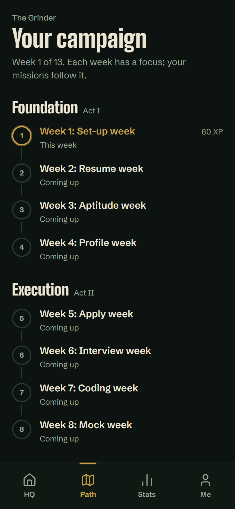
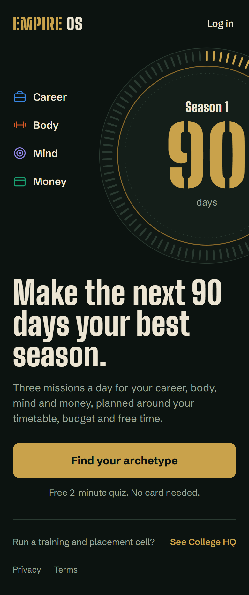
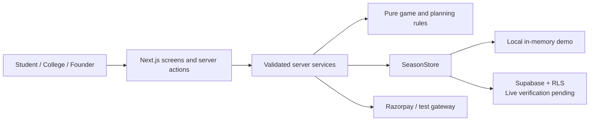

<p align="center">
  
</p>

# EMPIRE OS

   

**Turn your next 90 days into a season.** Three short daily missions across **Career, Body, Mind and Money**, fitted to a student's time, budget and equipment. Finish a mission ticket, earn XP, and adjust the next week through a short review.

Built for students and freshers in India, with **College HQ** for training and placement teams supporting consenting student batches.

[Take the reviewer tour](docs/DEMO.md) · [Read the case study](docs/CASE_STUDY.md) · [Explore the architecture](docs/ARCHITECTURE.md) · [Documentation](docs/README.md)

**Status:** built and tested locally; live Supabase, sign-in, Vercel and Razorpay verification are pending. There is no verified public demo. This repository is private, and screenshots use fictional local test data.

## See the app

<table>
  <tr><th>A plan with a reason</th><th>Today's mission tickets</th><th>A weekly reset</th></tr>
  <tr>
    <td valign="top"></td>
    <td valign="top"></td>
    <td valign="top"></td>
  </tr>
</table>

**Quiz → season preview → daily missions → weekly review → an adjusted plan.** The plan exists before sign-up, and its explanation reflects the student's answers.

### College HQ


The college view brings batch activity, sections, in-app reminders and printable weekly reports together. Students join with consent and can leave; journals and private quiz answers stay outside the college view. **All names, counts and activity above are sample data, not customer traction.**

<details>
<summary>See the season map and landing page</summary>

<table>
  <tr><th>The 90-day path</th><th>The first impression</th></tr>
  <tr>
    <td valign="top"></td>
    <td valign="top"></td>
  </tr>
</table>

</details>

These are screenshots of the running application. [Capture notes and refresh instructions](docs/images/README.md).

## What makes the loop useful

- **A plan that fits real constraints.** Phone-only, free-only and home-only answers affect eligible missions. The catalogue contains **120 core missions and four ten-mission packs**.
- **Choices the student can understand.** Explicit TypeScript rules select missions and explain the plan. V1 needs no AI API or model-generated coaching.
- **A week that can change.** War Room combines completion with difficulty and blockers to adjust future work. A new goal asks for confirmation before replacing the plan.
- **Progress shared by choice.** College HQ follows batch membership and consent. The student keeps their account and history after leaving a batch.

The product hypothesis is that small, specific actions make it easier to show up consistently. Employment, health, savings, retention and revenue outcomes have not been established with real users. Missions are general habits, not professional advice. [Product rules](docs/PRODUCT.md) · [Business hypotheses](docs/BUSINESS_VALUE.md).

## What is implemented

| Experience | Highlights |
| --- | --- |
| Start a season | Adult age gate, eleven-question quiz, six archetypes, three-act preview, oath and sign-up screens |
| Build daily momentum | DONE stamps, XP, six ranks, streaks, shields, daily bonus, swap/skip and **twelve activity-based medals** |
| Keep going | HQ, Path, Stats, Me, weekly adaptation and boss missions; **Season 2 retains XP, rank and medals** after the Day-90 debrief |
| Support a batch | Consent-based membership, overview, sections, student activity, reminders, invite poster and printable report |
| Manage access and data | Free tier, Season Pass reservations, referrals, share cards, JSON export and account deletion |
| Run the product | Founder HQ, return metrics, demo requests, launch checklist, college setup and a Razorpay integration behind a switch |

Payments remain in **reserve mode** by default; checkout has been tested against a local stand-in gateway. Hosted database, provider and real-device checks remain launch work. [Roadmap](docs/ROADMAP.md) · [Launch checklist](docs/LAUNCH_CHECKLIST.md).

The **campaign kit** visual system uses forest ink, brass and bone, perforated tickets, a season medallion and a red DONE stamp. Its phone-first target is 390 × 844, with 44px tap targets, reduced motion and table alternatives to charts. [Design specification](docs/DESIGN.md).

## Architecture at a glance



**Next.js 16 · React 19 · strict TypeScript · Tailwind CSS 4 · Supabase · Vitest · Playwright.** Services own authorization and game-state changes. The same service interface supports the local memory store and the live Supabase implementation. PGlite exercises the actual SQL migrations separately; it does not power the interactive demo. [Architecture](docs/ARCHITECTURE.md) · [API](docs/API.md) · [Security](docs/SECURITY.md).

## Try it locally without accounts

Use **Node.js 24** and npm. Repository access is required to clone.

```powershell
git clone https://github.com/akhil-itpro/empire-os.git
cd empire-os
npm.cmd ci

$env:EMPIRE_TEST_MODE='1'
$env:NEXT_PUBLIC_EMPIRE_TEST_MODE='1'
$env:EMPIRE_DIST_DIR='.next-test'
npm.cmd run dev -- --port 3200
```

Open **http://localhost:3200**, choose **Find your archetype**, complete the quiz and oath, then select **Test sign-in (local test mode)**. The [reviewer tour](docs/DEMO.md) includes sample answers, weekly review, Season 2 and the College HQ demo.

No Supabase account or key is required. The demo stores fictional records in memory and loses them on restart; use sample information only. Stop it before automated browser tests, which share `.next-test`. Use `npm` instead of `npm.cmd` outside Windows. [Complete setup and phone walkthrough](docs/SETUP.md).

## Verification you can inspect

**Checked 1 November 2026:** **214 unit/database/service tests across 14 files**, **12 portfolio browser journeys**, lint, type checking and documentation checks passed. The six gallery images were refreshed and visually reviewed. The latest full functional browser regression and production build were recorded by Claude on **26 October 2026**, including **58 functional browser scenarios plus screenshot journeys**. See the [testing guide](docs/TESTING.md) for scope and dated evidence.

The [testing guide](docs/TESTING.md) explains commands and coverage. Local tests exercise rules, service permissions, migrations and rendered workflows. Live Supabase isolation, real email/Google sign-in, Razorpay provider flows, phone sharing and broader accessibility acceptance still need verification.

## Explore the project

| For a closer look | Start here |
| --- | --- |
| Product and decisions | [Case study](docs/CASE_STUDY.md) · [Product](docs/PRODUCT.md) · [Design](docs/DESIGN.md) |
| Build and verify | [Setup](docs/SETUP.md) · [Testing](docs/TESTING.md) · [Architecture](docs/ARCHITECTURE.md) |
| Use each role | [Student](docs/manuals/STUDENT_GUIDE.md) · [College](docs/manuals/COLLEGE_GUIDE.md) · [Founder](docs/manuals/FOUNDER_GUIDE.md) |
| Prepare for launch | [Operations](docs/OPERATIONS.md) · [Security](docs/SECURITY.md) · [Launch checklist](docs/LAUNCH_CHECKLIST.md) |
| Continue development | [Handoff](HANDOFF.md) · [Contributing](CONTRIBUTING.md) · [All documentation](docs/README.md) |

## Project context and ownership

Portfolio owner: [Akhil Codes](https://github.com/akhil-itpro). The founder supplied product direction and built the application with Claude Code assistance. Codex expanded the portfolio presentation, documentation and verification.

No project-wide open-source license has been selected; repository access does not grant a new license. Operator/contact/refund placeholders and legal drafts still need founder and lawyer review before launch. [Security reporting](SECURITY.md) · [Current handoff](HANDOFF.md).
