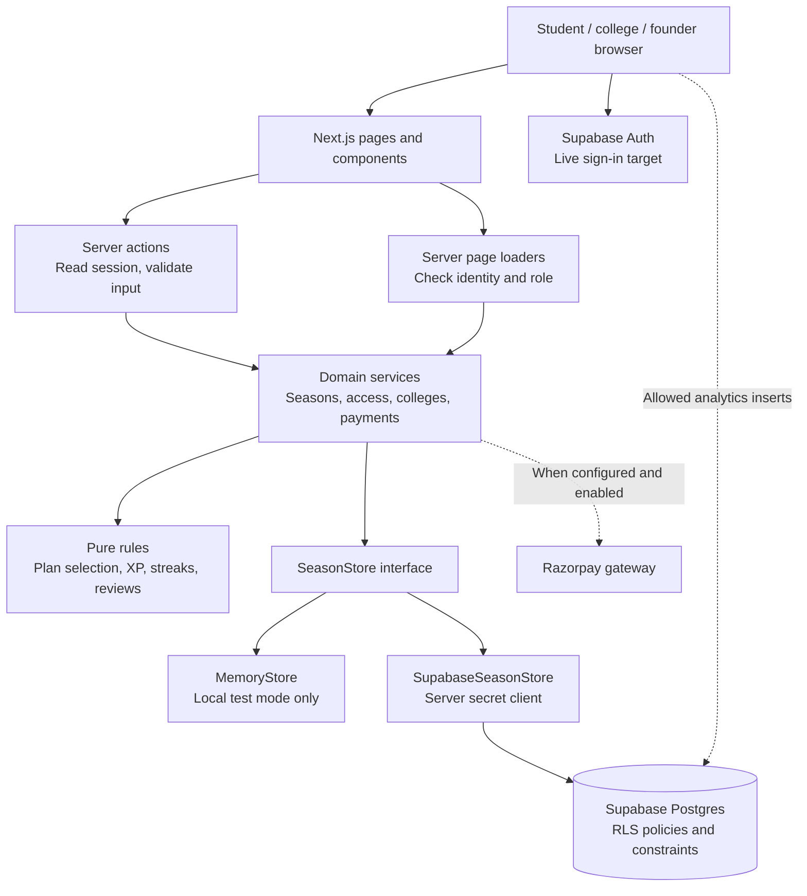

# Architecture

EMPIRE OS is one Next.js application for a student season, college administration and founder reporting. Its V1 planning engine uses fixed rules; there is no AI service in the product request path.

[Overview](../README.md) · [API](API.md) · [Security](SECURITY.md) · [Setup](SETUP.md) · [Testing](TESTING.md)

## System map

**Current evidence:** implemented flows run locally with a substitute store and payment gateway. The live Supabase, authentication, hosting and payment setup still needs verification. See [HANDOFF](../HANDOFF.md) for the current checkpoint.

## Layers and responsibilities

| Layer | Source | Responsibility |
| --- | --- | --- |
| Routes and presentation | [`app/`](../app/), [`components/`](../components/) | Marketing, quiz, student tabs, College HQ, Founder HQ and image/download responses |
| Mutation boundary | [`app/actions/`](../app/actions/) | Read the signed-in identity, call services and refresh the screen after successful changes |
| Domain services | [`lib/server/`](../lib/server/) | Ownership, role, access and input checks; coordinate reads and writes |
| Planning and game rules | [`lib/plan-engine/`](../lib/plan-engine/), [`lib/game/`](../lib/game/) | Deterministic mission selection, archetypes, XP, streaks, access and weekly adaptation |
| Persistence contract | [`store.ts`](../lib/server/store.ts) | Typed operations used by the services without tying them to one database implementation |
| Production data adapter | [`store-supabase.ts`](../lib/server/store-supabase.ts) | Map domain types to database rows using the server-only Supabase client |
| Local test adapter | [`store-memory.ts`](../lib/server/store-memory.ts) | Process-local data for unit/browser workflows without hosted accounts |
| Schema | [`supabase/migrations/`](../supabase/migrations/) | Eight ordered migrations covering schema, seed content, policies, college scope and payments |

[`deps.ts`](../lib/server/deps.ts) supplies `{ store, now, payments }` to services. Tests can control the clock and payment behavior instead of relying on the wall clock or a remote provider.

## Two runtime modes, plus a database test harness

| Context | Selection and behavior | Limitation |
| --- | --- | --- |
| Local test mode | `EMPIRE_TEST_MODE=1` while `NODE_ENV` is not `production`; `MemoryStore` and pretend identities | Data is held in the server process and disappears when it restarts. This is not an offline database or a production deployment mode |
| Live application | Server session claims, Supabase adapter and configured provider settings | Requires migrations, real authentication and integration testing before users rely on it |
| Migration tests | [`tests/unit/db.test.ts`](../tests/unit/db.test.ts) loads actual migrations into PGlite and recreates the Supabase roles and `auth.uid()` | Exercises SQL rules locally; does not verify a hosted Supabase project's settings |

`NEXT_PUBLIC_EMPIRE_TEST_MODE` directs browser analytics to the local test endpoint. It does not independently enable server test sign-in. Test login, test events and fake checkout endpoints return 404 outside server test mode. Do not set either test flag on a hosted deployment.

## A mission completion request

1. The student taps **Mark done**. The client sends the assigned mission row identifier to the server action; it does not submit a trusted XP amount or user identifier.
2. The action reads the identity through [`getSessionUserId()`](../lib/server/session.ts). In live mode this uses verified Supabase claims.
3. [`completeMission()`](../lib/server/season-service.ts) validates the identifier and profile, then updates only an open assignment belonging to that student on the current local date.
4. The store changes the eligible assignment and records an XP event. Unique grant references prevent the same mission or daily bonus from being granted twice.
5. The service recomputes progress and records product events. The action refreshes server-rendered data; the interface displays the completion stamp and updated totals.

The service accepts an authenticated user ID from its server caller. It is not safe to expose that service directly with a browser-supplied user ID. This convention is part of the authorization boundary.

## Data model by responsibility

| Group | Main tables | Important boundary |
| --- | --- | --- |
| Identity and plan | `profiles`, `roles` | Profile belongs to the login; roles are assigned by trusted server/database administration |
| Daily activity | `user_missions`, `xp_events`, `user_stats`, `journal_entries` | Students cannot directly write computed progress. Journal text remains private |
| Content | `mission_library`, `packs` | 120 base missions and four ten-mission packs; seed content is checked against the code library |
| Access and growth | `entitlements`, `reservations`, `referrals`, `payments` | Access is computed from dates and server-created grants; reservations do not represent payment |
| Weekly adaptation | `weekly_reviews` | One review per season/week; stored outcomes explain changes and preserve the result screen |
| College scope | `orgs`, `org_admins`, `org_invites`, `batches`, `batch_members`, `nudges` | College access depends on organization administration and consenting current membership |
| Service reporting | `events`, `launch_checklist`, `demo_requests` | Server checks founder access; browser analytics is restricted to permitted inserts |

Schema types are currently maintained in [`lib/supabase/types.ts`](../lib/supabase/types.ts). Regenerating and comparing them with the live schema is a launch follow-up.

## Security has two boundaries

The browser's publishable-key database access is restricted by row-level security (RLS), grants and constraints. RLS means the database applies rules to decide which rows a signed-in person may access. Student reads are scoped to their own data; college administrators get permitted member progress for their organization and season, without journal or quiz access.

Application services use a **server-only secret client that bypasses RLS**. Their own session, ownership and role checks are therefore essential. RLS alone does not authorize a service operation. [`admin.ts`](../lib/supabase/admin.ts) is marked `server-only` to prevent browser imports; the secret must never use a `NEXT_PUBLIC_` variable.

[`proxy.ts`](../proxy.ts) refreshes the live session cookie for signed-in routes. It is not the permission check: pages, actions and services must still enforce access. See the [security model](SECURITY.md) for the evidence and remaining verification work.

## Planning and weekly adaptation

[`previewPlan()`](../lib/plan-engine/preview.ts) produces an archetype, sample missions and season milestones before sign-up without saving a profile. Daily selection considers pillar order, available minutes, budget, equipment, act, difficulty, archetype and recent history. [`PLAN_CONFIG`](../lib/plan-engine/config.ts) holds the selection and adaptation settings.

The War Room combines the finished week's activity with the student's review. [`adaptNextWeek()`](../lib/plan-engine/war-room.ts) returns the next week's adjustments and plain-language reasons. Goal/city proposals require a separate decision; previous mission history and earned XP are preserved.

## Integration boundaries and tradeoffs

| Choice | Benefit | Cost or follow-up |
| --- | --- | --- |
| Rule-based planning | Explainable outputs and repeatable tests without AI request cost | Content quality and rule changes need human review |
| Shared store interface | The same services run against a real adapter or test substitute | Memory-store success can hide provider/schema integration differences |
| Server-owned progress | The browser cannot choose XP, price, pass dates or roles | Each privileged operation must retain explicit authorization checks |
| XP ledger and grant sources | Duplicate progress/access requests have stable identities | Multi-step operations still require failure/retry verification on live infrastructure |
| Consent-based College HQ | Colleges see participation for joined students and can print reports | Leaving removes visibility and can end batch access; operators must explain this clearly |
| Payment gateway interface | Local success/failure/replay tests are repeatable | Real checkout, webhook delivery and in-app-browser redirects remain separate tests |
| Next.js Cache Components | Public and per-request work can be composed in one app | Personal data must remain request-scoped; use the installed Next.js guides before route/cache changes |

The current code has no scheduled background-job or cron route. Today is generated by service calls when needed; weekly reviews depend on the student's visit. Do not assume automated reminders or notifications exist.

Continue with the [API reference](API.md), [operations runbook](OPERATIONS.md), [case study](CASE_STUDY.md) and [launch checklist](LAUNCH_CHECKLIST.md).
