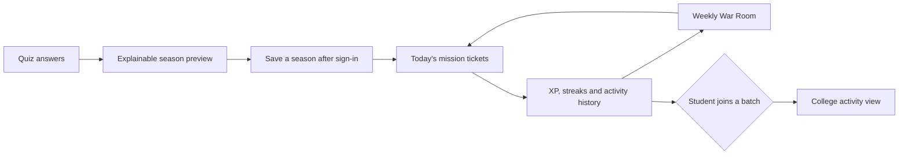

# EMPIRE OS: turning a 90-day goal into a daily mission loop

[Project overview](../README.md) · [Reviewer tour](DEMO.md) · [Documentation hub](README.md)

EMPIRE OS is a founder-led, AI-assisted web app for students and freshers in India. It turns a short quiz into a 90-day season across Career, Body, Mind and Money, then gives the student a small set of missions to finish today.

The application is implemented and demonstrated in local test mode. Real Supabase authentication and data storage, Vercel hosting and Razorpay provider verification remain launch work. This case study claims no customer adoption, revenue, placement improvement or measured habit change.

## The product challenge

A broad goal such as “get my first job” does not tell a student what to do after class. A useful plan must fit the time, equipment and money they actually have. A Pune student with a phone and a free-only budget should not receive the same work as someone with a laptop, gym access and 90 minutes available.

The product hypothesis is that a short daily loop, visible progress and a weekly adjustment will make it easier to keep showing up. A second hypothesis is that a college training and placement cell will pay for a consenting batch's activity view and follow-up tools. Both need real-user validation.

## The experience delivered

| Person | Implemented workflow | Boundary |
| --- | --- | --- |
| New visitor | Adult age check, 11-question quiz, archetype reveal, three-act preview and oath before sign-up | The “under three minutes” first-session target still needs timed phone validation |
| Student | HQ mission tickets, instructions, completion stamps, XP, ranks, streaks, Path, Stats and plan editing | Completion is self-reported activity, not verified skill or wellbeing |
| Returning student | Weekly War Room with a proposed adjustment and an explanation | Adaptation follows explicit rules; there is no AI coach |
| College admin | Opt-in batch overview, sections, student activity, in-app nudges and printable reports | Journal entries and quiz answers are excluded from the college view |
| Founder | Funnel and return metrics, reservations, college setup, demo requests and launch checklist | Dashboard activity in a local demo is generated or test activity |

## Decisions that make the product coherent

### Use rules for personalization

Cost and equipment define mission eligibility. Scoring favors the current act and target difficulty; selection prefers the time budget and five-day freshness window, with repeat and shortest-mission fallbacks when no fresh fitting mission remains. Pillar priorities determine the daily slots. The catalogue contains 120 core missions and four 10-mission packs. The preview uses the same domain rather than inventing an unrelated marketing result.

This makes a specific recommendation explainable: the screen can say that a student chose free resources or has only a phone. It also allows tests to compare constrained and flexible answer sets without waiting for a model response. The tradeoff is a finite library and a rule configuration that need editorial care as usage grows.

See [plan-engine code](../lib/plan-engine/), [plan-engine tests](../tests/unit/plan-engine.test.ts) and [product rules](PRODUCT.md).

### Make progress tangible without making it a judgement

The campaign-kit design uses deep green, brass, mission tickets, medallions and a red DONE stamp. Completing a mission is the signature moment: the ticket is stamped and XP counts up. Path groups 13 weeks into Foundation, Execution and Ascension.

The design keeps the reward tied to effort inside the app. XP does not measure a person's worth, income, fitness or employability. A missed day uses calm recovery copy. Reduced-motion behavior and text labels accompany the visual states; automated accessibility checks cover selected flows, while full real-device and assistive-technology acceptance remain open.

See the [design system](DESIGN.md), [mission sheet](../app/(app)/(tabs)/hq/MissionSheet.tsx) and [daily-loop tests](../tests/e2e/daily-loop.spec.ts).

### Adjust future work while preserving the past

The War Room combines actual completion with the student's stated difficulty and blocker. A hard week can reduce the next week's time and difficulty. A money blocker can select free-only work. A strong week can add a boss mission. The result explains what changed using the recorded counts.

A city or goal change proposes a new plan and asks “Apply new plan?” before applying it. Normal plan edits start tomorrow. Neither flow rewrites past completion, XP or rank. This separates a useful change of direction from erasing progress.

See [War Room rules](../lib/plan-engine/war-room.ts), [service](../lib/server/war-room-service.ts) and [browser scenarios](../tests/e2e/war-room.spec.ts).

### Treat college access as a student choice

College HQ is connected to batch membership, rather than giving a college access to every registered student. Joining shows the progress-sharing explanation and requires an explicit action. Students choose their section and may supply a last-name initial. They can leave while retaining their account and history; any access supplied by that batch ends.

The database migrations define organization boundaries, while server services check the acting user. Local database and service tests provide evidence for those boundaries; running the live Supabase isolation check is still required. The sample batch is labelled “Sample data” and its join code cannot enroll real students.

See [college service](../lib/server/college-service.ts), [college tests](../tests/unit/college.test.ts), [database tests](../tests/unit/db.test.ts) and the [college manual](manuals/COLLEGE_GUIDE.md).

### Separate entitlement from a checkout screen

The Free plan, trial, Season Pass, college batch access and referral bonus are evaluated on the server. The default offer reserves a price and explicitly states that no payment was taken. When enabled, the payment service computes the order price and verifies provider results before granting access. Repeated callbacks and webhooks must not create repeated grants.

The checkout and failure paths have a local stand-in gateway. They still need Razorpay test credentials, real webhook validation and in-app browser acceptance before launch. The product also retains commercial gates: provider onboarding, legal/operator readiness, actual reservations and the specified Day-7 return threshold.

See [access rules](../lib/game/access.ts), [payment service](../lib/server/payment-service.ts), [payment tests](../tests/unit/payments.test.ts) and [launch checklist](LAUNCH_CHECKLIST.md).

## How the work is reviewable

Pure game and planning functions are tested separately from services. A `SeasonStore` interface connects the same services to an in-memory local store or the Supabase implementation. Playwright exercises the funnel, student loop, trust controls, college view, weekly review, growth and payment stand-in at phone size.

That separation makes a review possible without external accounts, and keeps provider setup from blocking UI and domain verification. The local store is process memory: restarting the server loses the demonstration records. Local success cannot prove a production database, account configuration or payment integration is ready.

The [testing guide](TESTING.md) records evidence and limits. The [architecture guide](ARCHITECTURE.md) explains the trust boundaries. [HANDOFF.md](../HANDOFF.md) and the [session log](SESSION_LOG.md) preserve the state between Claude Code and Codex sessions.

## What remains unproven

The next milestone is live infrastructure verification followed by controlled founder testing. Customer retention, willingness to pay, college procurement, support effort and commercial viability remain hypotheses. General habit missions do not establish medical, financial, legal or placement outcomes.

See the [roadmap](ROADMAP.md) for implementation versus launch status, and [business value](BUSINESS_VALUE.md) for the proposed offers and measurement plan.

The founder supplied the product direction and built the app with Claude Code assistance. Codex expanded the portfolio presentation and documentation. This is an openly AI-assisted project whose source, tests, decisions and unfinished validation can be inspected.
